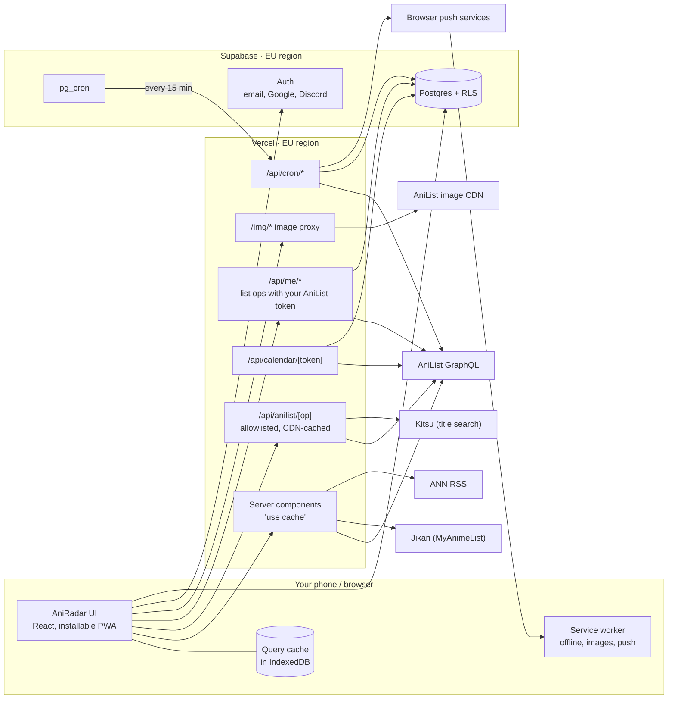
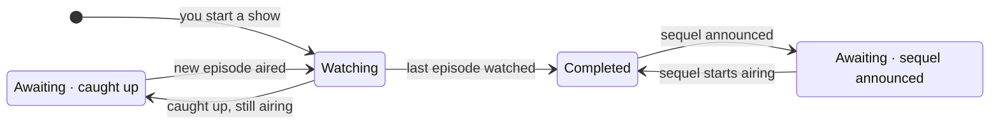

# AniRadar — Plan

> **Status:** Phase 0 done, waiting for your review (branch `phase-0-foundation`, not committed yet) · **Updated:** 2026-11-02 · **Next:** Phase 1 (Browse & search) after your OK
>
> Nothing has been installed or scaffolded yet; the repo still contains only `README.md`.

**How to read this:** start with **§1**. It covers a problem in AniList's API terms that changes the core design. **§2** lists the questions I need answered, each with a recommended default. From §3 on, everything describes the recommended direction, and I'll revise it once you've decided.

## TL;DR

- **AniRadar** is a mobile-first PWA for finding anime, tracking it and planning what to watch. It's dark and built around key art, and it stays fast through layered caching.
- **Blocker:** AniList's API terms (reworded on 18 Aug 2026) forbid using AniList data in a *separate* list or tracker service. That covers both anime data and imported user lists. Your spec, an own watchlist in Supabase plus an AniList import, falls under it.
- **Recommendation:** build AniRadar as a **companion app for AniList**:
  - Your list, progress and scores live in your AniList account, read and written through the official API.
  - AniRadar adds what AniList doesn't have: the "Awaiting new episodes" smart status, the streaming filter, a personal weekly schedule, a calendar subscription, the feed and push notifications, MAL scores, and news.
  - Supabase stores only those extras.
- **Stack:** Next.js 16 (App Router) + TypeScript 6 + Tailwind 4 + shadcn/ui + TanStack Query 5 + Supabase (EU) + Serwist (PWA), hosted on Vercel (EU functions).
- **10 phases**, each ending in something you can run and test. I stop after each one for your review.

## Contents

1. [Decision needed first: AniList's terms of use](#1-decision-needed-first-anilists-terms-of-use)
2. [Open questions](#2-open-questions)
3. [Product overview](#3-product-overview-direction-a)
4. [Architecture](#4-architecture)
5. [Tech stack](#5-tech-stack)
6. [Data sources, limits & compliance](#6-data-sources-limits--compliance)
7. [API layer & caching](#7-api-layer--caching)
8. [Data model, RLS & security](#8-data-model-rls--security)
9. [Sign-in & AniList connection](#9-sign-in--anilist-connection)
10. [Feature specs](#10-feature-specs)
11. [UI/UX](#11-uiux)
12. [PWA & offline](#12-pwa--offline)
13. [Privacy & GDPR](#13-privacy--gdpr)
14. [Testing & definition of done](#14-testing--definition-of-done)
15. [Roadmap](#15-roadmap)
16. [Risks](#16-risks)
17. [Conventions (becomes CLAUDE.md)](#17-conventions-becomes-claudemd-in-phase-0)
18. [Progress log](#18-progress-log)
- [Appendix A — the other directions](#appendix-a--the-other-directions)
- [Appendix B — sources checked](#appendix-b--sources-checked-2026-11-02)

---

## 1. Decision needed first: AniList's terms of use

**What I found.** Point 5 of AniList's API terms bans using the API in services that compete with AniList instead of complementing it. It names "anime and manga list or tracker services" explicitly and covers both media data and user data. The wording changed on 18 Aug 2026. Before that, a competing tracker could ask for permission if it synced deeply with AniList accounts. The change removed that option, and the commit that made it says plainly that exception requests are being refused.

**What that means for the spec as written.** A tracker that keeps its own watchlist in Supabase and gets anime data from AniList is exactly the case that's banned. Importing an AniList list into such a tracker is banned too. What's still allowed is a *client*: an app that uses the user's AniList account *as* the list and reads and writes it through OAuth. That's what AniList's API and OAuth are for.

| | **A. Companion for AniList** (recommended) | B. Independent tracker without AniList | C. Build the spec as written |
|---|---|---|---|
| Your list lives in | your AniList account (two-way sync) | AniRadar's database | AniRadar's database |
| Anime data from | AniList (+ MAL scores, news) | TMDB and others (Appendix A) | AniList |
| AniList import | not needed: your list is already there | not allowed | not allowed |
| Terms | compliant | each source needs checking; MAL's terms are restrictive too | breaks point 5; AniList can block the app or its IPs |
| Data quality | best: banners, cover colours, per-episode air times, tags, voice actors, relations, streaming links | much weaker for anime | best, until blocked |

**Decided (2026-11-02): A.** It keeps the best data source and is clearly allowed. Almost every feature you asked for stays, and some get simpler: there's no import step, and we store less personal data.

**What changes under A**

| Your spec | Under A |
|---|---|
| Watchlist & ratings stored in Supabase | Stored in your AniList account; AniRadar reads and writes them. Supabase holds only AniRadar's extras: settings, notification toggles, status overrides, feed, calendar and push tokens. |
| AniList OAuth only for a one-time import | List features need **Connect AniList**. There's no import step, because the list syncs both ways: edits you make on anilist.co show up in AniRadar too. |
| Don't store the AniList token unless needed; if stored, server-side only | It *is* needed, for ongoing sync. It's stored server-side only, encrypted (AES-256-GCM, key in an env var), in a schema the public API can't reach. It's deleted when you disconnect or delete your account. AniList tokens last a year and can't be refreshed, so AniRadar asks you to reconnect before yours expires. |
| Statuses: Want to watch / Watching / Awaiting new episodes / Completed / Dropped | They map to AniList's PLANNING / CURRENT / *(AniRadar smart status)* / COMPLETED / DROPPED. AniList also has Paused and Rewatching, and those are shown too. AniRadar computes "Awaiting" on top of AniList data and stores your manual overrides in Supabase. |
| Ratings 1–10 with half points | Your AniList score. Exact half points need the "10 Point Decimal" score format in your AniList settings. AniRadar checks your format and warns you if it would round. |
| Guests build a local list, moved into the account on sign-up | Dropped: a local list kept outside AniList is the banned non-complementary case. Guests can still browse, search, open details, and see seasons, schedules and news. |
| Magic link + Google + Discord via Supabase Auth | Unchanged; that's your AniRadar account. Connecting AniList is one extra step after sign-in. Password sign-in stays disabled. |
| GDPR export and deletion | Simpler: they cover only AniRadar's data. Your AniList account and list fall under AniList's responsibility, and AniRadar links to the AniList setting where you can revoke its access. |

If you prefer B or C, Appendix A shows what changes.

---

## 2. Open questions

1. ~~**Direction (§1):** A, B or C?~~ **Decided: A**, a companion app for AniList.
2. **Sign-in:** **Decided: Supabase sign-in** (email, Google, Discord), plus a one-time "Connect AniList" step.
3. **Audience:** just you, friends, or anyone? This decides three things:
   - when we need a proper email provider (Supabase's built-in email reaches only your project team, and only 2 emails per hour)
   - how much the free tiers have to handle
   - how formal the privacy policy needs to be

   **Decided: personal use plus friends** (non-commercial, so Vercel Hobby and the free Supabase plan fit). Supabase's built-in email reaches only you, so friends sign in with Google or Discord at first. Email sign-in for friends needs a custom SMTP provider (a free tier is enough), which can be added in Phase 3 or later.
4. **Phone and region:** **Decided: Android, Nordics.** Supabase in Stockholm (`eu-north-1`) and Vercel functions in `arn1`; default time zone Europe/Stockholm. Android means push works in Chrome and in the installed app, and calendar subscription goes through calendar.google.com ("From URL"). iPhone paths still get basic testing for friends.
5. **When an announced sequel starts airing:** **Decided: only tell me.** A feed item offers one-tap "Start watching"; nothing is written to AniList automatically. Auto-add stays available as an optional setting.
6. **Accounts and tooling.** I can't create accounts or enter secrets, so you'd create these; I'll give step-by-step instructions in the phase that needs each one:
   - a Vercel account
   - two free Supabase projects (dev and prod)
   - Google and Discord OAuth apps
   - two AniList API clients

   Docker isn't installed on this machine. Can you install Docker Desktop or an alternative, so Supabase can run locally? If not, the database tests run in GitHub Actions and local development uses the dev project. **Decided: no Docker.** Local development uses the dev project; database tests run in GitHub Actions.
7. **Privacy policy:** **Decided:** the data controller is Malin Sommar, contact malinsommar1997@gmail.com.
8. **Git workflow:** **Decided: one branch and pull request per phase.** You review and merge; I ask before every commit and push.
9. **Series or seasons?** (2026-11-03, after Phase 2) **Decided: series first.** You search, browse, follow and get notified per *series*; seasons live inside the series page. AniList itself stays per season, so AniRadar adds the series layer on top (§10.0).
   - Movies in the main story count as part of the series.
   - Ratings: both: a score per season (in AniList) and a score for the whole series (in AniRadar).
   - Spin-offs are separate series, but still listed under "Side stories & specials" on the detail page. Each series gets an option to "Track all side stories and specials" too.
   - In browse, a new season whose earlier seasons aren't among the results shows as itself, labelled with the season it continues (my call; easy to change later).

**Confirmed:**
- English UI.
- Adult content off by default, with a switch in settings to show it (behind an "I'm 18 or older" confirmation).
- Titles in English, falling back to romaji (changeable in settings).
- Spoiler tags hidden.
- App name "AniRadar", which fits AniList's naming rules.
- pnpm as the package manager, enabled through corepack (corepack is installed).

---

## 3. Product overview (direction A)

AniRadar is a fast, installable companion for AniList. You can find anime, see everything about a show in one place, track it with one tap, and never miss an episode.

| Feature | Data from | Stored by AniRadar | Phase |
|---|---|---|---|
| Browse & search | AniList; Kitsu (partial-word title matching) | — | 1 |
| Detail page | AniList, Jikan (MAL score) | — | 2 |
| Account | Supabase Auth | email, sign-in identities | 3 |
| AniList connection | AniList OAuth | encrypted token, AniList user ID and name | 3 |
| My list & ratings | your AniList list | status overrides, notification toggles | 4 |
| Smart "Awaiting" status | computed from airing data and relations | overrides only | 4 |
| Streaming filter | AniList streaming links | your "My services" choice | 4 |
| Home & "New for you" | AniList, Jikan, ANN | feed events (IDs and times) | 5 |
| Schedule & seasons | AniList airing schedules | — | 6 |
| Calendar (.ics) | AniList | hash of your calendar token | 6 |
| News | Jikan (per anime), ANN RSS (latest) | — | 7 |
| Offline & install | service worker, on-device cache | on your device only | 8 |
| Push notifications | AniList airing data and your list | push subscriptions, list snapshot (IDs, status, progress) | 9 |

**Screens:** `/` Home · `/browse` · `/anime/[id]/[slug]` · `/season/[year]/[season]` · `/schedule` · `/list` · `/ratings` · `/feed` · `/settings/*` · `/login` · `/privacy` · `/about` · `/~offline`

**Navigation:**
- Phone: a bottom tab bar with Home · Browse · Schedule · My List · Me.
- Desktop: a top bar.
- Search is one tap away on every screen, and Ctrl/⌘ K opens it on desktop.

---

## 4. Architecture



**Key decisions**

1. **One AniList module with two transports.** All AniList access goes through `src/lib/anilist`.
   - On the server it calls AniList directly, inside Next's cache.
   - In the browser it calls our `/api/anilist/[op]` route, which accepts only allowlisted operations and returns GET responses the CDN can cache.

   That gives one place for rate limiting and back-off, and a cache shared by all your devices. It also means your browser never talks to third parties. If shared server IPs ever cause rate-limit trouble, the browser transport can switch to calling AniList directly.
2. **Personal list operations run on the server** (`/api/me/*`), because the AniList token never leaves it.
3. **Rendering.**
   - Public pages (browse, detail, season) are server-rendered from cache and handed over to TanStack Query.
   - Personal pages (list, ratings, schedule) are client-rendered shells that read the persisted query cache, so they open instantly and work offline.
4. **Pure domain logic lives in `src/domain`.** That covers smart status, season ordering, feed rules and calendar generation. The UI, API routes and scheduled jobs all share it, and it's unit-tested.
5. **Scheduled jobs:** Supabase `pg_cron` calls our `/api/cron/*` routes with a shared secret. Vercel's free plan only allows cron jobs once a day, which is too rare for episode alerts.
6. **Images come through our own domain** (`/img/*`, cached by the CDN). That's better for privacy, and it lets the service worker cache covers for offline use. A config flag switches back to AniList's CDN if bandwidth ever becomes a problem.
7. **The list sits behind a `ListRepository` interface.** The first implementation is AniList via our server. That keeps the backend swappable, as you asked, if AniList's terms or your direction ever change.

---

## 5. Tech stack

Versions are the npm releases current on 2026-11-02; Phase 0 pins exact versions.

| Area | Choice | Why |
|---|---|---|
| Framework | **Next.js 16.4** (App Router, Turbopack, React 19.3, React Compiler) | UI and server endpoints in one codebase. We need a server anyway: OAuth secret exchange, the AniList proxy, the calendar feed, cron targets, push and account deletion. Server components plus caching make public pages fast. Matches your starting idea. |
| Language | **TypeScript 6.0**, strict | TypeScript 7 (the new native compiler) is out, but typescript-eslint only supports versions below 6.1. Revisit later. |
| Styling | **Tailwind CSS 4.3**, design tokens as CSS variables (OKLCH) | fast iteration, dark-first theming, and each anime's accent colour via a CSS variable |
| UI parts | **shadcn/ui** (Radix), lucide icons, sonner (toasts), vaul (bottom sheets) | accessible building blocks that live in our repo and can be restyled freely |
| Data fetching | **TanStack Query 5** + a persister to IndexedDB (idb-keyval) | caching, request deduplication, infinite scroll, optimistic updates, an offline mutation queue, instant reloads |
| URL state | **nuqs** | typed search params, so filters can be shared and survive Back |
| GraphQL | **GraphQL Code Generator** (client preset) against AniList's schema, with plain `fetch` | typed operations without a heavy GraphQL client; TanStack Query already handles caching |
| Validation | **Zod 4** | env vars, REST responses (Jikan, RSS), route inputs |
| Backend | **Supabase** (Postgres, Auth, pg_cron, pg_net) in an EU region, with `@supabase/supabase-js` 2.118 + `@supabase/ssr` 0.12 | your choice; RLS; built-in auth providers; scheduled jobs on the free plan. New projects use the new publishable and secret keys, because the legacy anon/service_role keys are being deprecated by the end of 2026. |
| PWA | **Serwist** (`@serwist/turbopack` 9.5) | maintained fork of Workbox for Next.js, with a Turbopack-compatible variant; the webpack plugin is the fallback |
| Push | **web-push** (VAPID) | the standard library for all browser push services |
| Calendar | **ical-generator** 11 | correct escaping and line folding |
| News | **fast-xml-parser** + **sanitize-html** | a small RSS parser plus HTML allowlisting |
| Dates | **date-fns 4** + `@date-fns/tz` | time-zone-safe formatting (Temporal isn't in every browser yet) |
| Tests | **Vitest 5**, Testing Library, **MSW 3**, **Playwright 1.64**, **pgTAP** via the Supabase CLI | unit, component, API-mock, end-to-end and database-policy tests |
| Lint/format | **ESLint 9** (flat config, `eslint-config-next`) + **Prettier 3** (+ Tailwind plugin) | Next 16 removed `next lint`, so we run the ESLint CLI directly. ESLint 10 waits until eslint-plugin-react, -import and -jsx-a11y support it |
| Package manager | **pnpm 10.34** via corepack | fast and strict. pnpm 12 is out, but the installed corepack (0.34) can't run it, and 10.x is the best supported on Vercel and GitHub Actions |
| Hosting | **Vercel** (Hobby plan to start), functions in an EU region next to Supabase | zero-config for Next.js and free for non-commercial use; every branch gets a preview URL, which makes testing on your phone easy |
| CI | **GitHub Actions** | the repo is already on GitHub |

**Considered and not chosen:**
- **Vite + React SPA:** simpler PWA tooling, but it needs a separate backend for OAuth, the calendar, cron and push.
- **Supabase Edge Functions for server logic:** that splits the code between Deno and Node and makes sharing domain logic and tests harder. We use only `pg_cron` there.
- **Apollo/urql:** normalized caches we don't need on top of TanStack Query.
- **gql.tada:** nice type inference, but AniList's large schema slows the TypeScript server.
- **Biome instead of ESLint + Prettier:** faster, but weaker coverage of Next.js and React Hooks rules.

---

## 6. Data sources, limits & compliance

### AniList (primary)

- **What we use:**
  - search and filters
  - details: titles, cover with its `color`, banner, description, genres, tags with spoiler flags, studios, scores, episodes, duration, dates, trailer
  - characters with Japanese and English voice actors (one query with two aliases)
  - relations (`relationType(version: 2)`)
  - streaming links (`externalLinks` of type STREAMING, plus `streamingEpisodes`)
  - `nextAiringEpisode` and `airingSchedule`
  - trending and seasonal lists
  - your list (`MediaListCollection`) and edits to it (`SaveMediaListEntry`, `DeleteMediaListEntry`)
  - `idMal`, to reach MAL data
- **Limits:**
  - The documented limit is 90 requests/min, currently degraded to **30/min**, plus a burst limiter with unpublished thresholds.
  - Going over the limit triggers a one-minute timeout. While it lasts, responses are 429 with `Retry-After` and `X-RateLimit-Reset`.
  - Every response carries `X-RateLimit-Limit` and `X-RateLimit-Remaining`.
  - When the API is switched off, it returns 403 with a message.
  - Errors can arrive with HTTP 200, so we always check `errors`.
  - `pageInfo.total` and `lastPage` are unreliable, so only `hasNextPage` drives pagination.
  - A `Page` can contain only one data field, but a single request can hold several aliased `Page` fields.
- **Terms checklist:**
  - ✔ Non-commercial (and free anyway below $150/month in revenue).
  - ✔ Never used as a backup or data store: no AniRadar data in AniList fields, and no copies of AniList data beyond short-lived caches.
  - ✔ No hoarding: no crawling or bulk prefetching; caches fill on demand and expire.
  - ✔ Naming: "AniRadar" contains neither "AniList" nor "AniChart". The OAuth clients will be named "AniRadar" and "AniRadar (dev)".
  - ✔ Complementary: direction A.
- **Adult content:** off by default. Queries send `isAdult: false` and adult genres and tags are hidden, unless you switch on "Show adult content" in settings (after an 18+ confirmation; saved on the device until Phase 3 moves it to the profile). Showing adult content leaves `isAdult` out of the query: an explicit `null` makes AniList return nothing. The setting is part of every cache key, so adult results never leak into the default cache. AniList warns that ecchi isn't flagged as adult; that's fine for a web app, but worth knowing if an app store is ever planned.
- **OAuth:**
  - We use the authorization code grant, with the client secret kept on the server.
  - Redirect URIs must match exactly, so there's one client for localhost and one for production.
  - Tokens are JWTs valid for a year, with no refresh and no scopes. They give almost full access to the account, so we treat them as highly sensitive.
- **Attribution:** "Data from AniList" in the footer and on the About page, and every detail page links to its AniList page.

### Jikan / MyAnimeList (secondary)

- **What we use:** MAL score, rank and member count on the detail page; per-anime news (MAL news) in Phase 7.
- **Limits:** documented as 3 req/s and 60 req/min. Responses are cached upstream, and availability varies, so Jikan data never blocks a page.
- **Terms:** Jikan is unofficial and works by scraping MyAnimeList. It disclaims any affiliation and leaves respecting MAL's terms to the user. We keep usage light (one call per detail view, cached 24 h), credit MyAnimeList, and link to the MAL page. If Jikan turns out unreliable for scores, the official MAL API (which needs a client ID) can take over, but it has no news endpoint.

### Kitsu (title search helper)

- **Why:** AniList's `search` only matches whole words: "juju" finds "Puka Puka Juju" but not "Jujutsu Kaisen", and "frier" finds nothing. Kitsu's anime search matches partial words and its results carry AniList IDs.
- **What we use:** only the AniList IDs of the top 20 matches for the typed text (`/api/title-matches`). The shows themselves still come from AniList; nothing from Kitsu is shown or stored.
- **Limits and failure:** no published limit. Our server limits itself to 60/min, caches each search for 30 minutes and gives up after 3 s. If Kitsu fails, search quietly falls back to AniList alone.
- **Terms:** I couldn't find published API terms (see Appendix A). It's a public, keyless API that Kitsu documents for third-party apps; usage here is light and read-only. Revisit if the app grows beyond friends.

### Anime News Network RSS

- Latest news on Home: headline, date, short excerpt and a link to ANN. It's fetched on the server, sanitized and cached for 30 minutes. We never show full articles.

### TMDB (later, optional)

- Region-specific "where to watch" data (from JustWatch) for the streaming filter. It needs an AniList → TMDB ID mapping.
- Terms:
  - non-commercial licence
  - the TMDB logo plus a "not endorsed by TMDB" notice
  - caching limited to 6 months
  - a JustWatch credit for provider data
  - no use in AI/ML applications

### Images

- AniList's CDN serves covers in `medium`, `large` and `extraLarge`, plus banners. We pick the size to fit each context and don't process images on the server.

---

## 7. API layer & caching

### 7.1 Shaping requests

- **One query per screen**, built from shared fragments (`MediaCard`, `MediaDetail`, `CharacterCard`…).
- **Several sections per request** using aliases: Home's trending, this season and next season come back in one call.
- **ID batching:** a small DataLoader-style batcher collects media IDs for about 10 ms, fetches them with `Page(perPage: 50) { media(id_in: …) }`, and fills in a cache entry per ID.
- **Search** is debounced by 300 ms, starts at 2 characters, and cancels superseded requests.
- **Prefetching only on intent** (hover, press, card in view), in the lowest-priority lane.

**Request budget** (AniList calls on a cold cache)

| Screen | Calls | Notes |
|---|---|---|
| Home (guest) | 1 | trending + this season + next season, aliased |
| Home (signed in) | +1–2 | your list (shared with My List) + this week's airing |
| Browse/search | 1 per 30 results | cached per filter combination |
| Detail | 1 (+1–3 for the season chain) | + 1 Jikan call; more characters load on demand |
| My list | 1 | `MediaListCollection`; sequel checks run in the background (1 per 50 completed shows, cached 24 h) |
| Schedule (week) | 1–2 | `airingSchedules(mediaId_in: …)`, 50 per page |

### 7.2 Cache layers

| Layer | What | Notes |
|---|---|---|
| TanStack Query (memory) | everything | `staleTime` per data class (below); deduplicates identical requests |
| IndexedDB (persisted query cache) | your list, media cards, genres and tags | max age 7 days; cleared on a new app version or sign-out; makes offline use possible |
| Service worker (Phase 8) | app shell, images, visited pages | images cache-first for 30 days, capped at about 400 |
| Vercel CDN | `/api/anilist/*` GET and `/img/*` | `s-maxage` + `stale-while-revalidate` per data class; shared by all users and devices |
| Next.js server cache | fetches in server components | `'use cache'` with `cacheLife` profiles and tags |
| In-flight dedupe | identical concurrent requests | only one upstream call |

**Freshness per data class**

| Data | Fresh for | Stale data shown for up to |
|---|---|---|
| Genre and tag lists | 7 days | 30 days |
| Core media details | 6 h | 1 day |
| Airing info (next episode, schedule) | 15 min, plus a refetch when a countdown hits 0 | 1 h |
| Trending, search, browse pages | 30 min | 6 h |
| Seasonal lists | 6 h | 1 day |
| Relations, season chain, characters | 24 h | 7 days |
| MAL score (Jikan) | 24 h | 7 days |
| News (Jikan / ANN) | 6 h / 30 min | 1 day |
| Your list | refetched when the app opens or regains focus | never in a shared cache (`private, no-store`) |

### 7.3 Rate limiting & errors

- **Token bucket** per server instance and per browser tab: capacity 5, refilling at 25/min (headroom under the 30/min limit), with at most 2 requests in flight. It adapts to `X-RateLimit-Limit` and `X-RateLimit-Remaining`, so it speeds up on its own if AniList goes back to 90/min.
- **Priority lanes:** whatever you're looking at comes first, then prefetching, then background work (feed, sequel checks).
- **429:** the whole queue pauses until `Retry-After` / `X-RateLimit-Reset` (plus jitter), then retries, at most 3 times.
- **5xx and network errors:** exponential back-off with full jitter, from 0.5 s to 8 s, at most 3 attempts.
- **403 "API disabled":** a circuit breaker stays open for 5 minutes, and cached data is shown with a banner.
- **GraphQL errors with HTTP 200** become typed errors. Each query decides how to handle partial data.
- **In the UI:**
  - A screen never goes blank; old data stays visible while errors are retried.
  - Skeletons appear only on the first load.
  - A toast says "AniList is busy — showing saved data".
- **Visibility:** a dev-only debug panel shows cache hits, queue length and the limiter's state, and the server logs every 429.

---

## 8. Data model, RLS & security

We store only AniList IDs and AniRadar's own data, never copies of anime data.

```sql
-- public: reachable through Supabase's Data API; RLS on every table
create table public.profiles (
  user_id          uuid primary key references auth.users on delete cascade,
  title_language   text not null default 'english',      -- english | romaji | native
  show_adult       boolean not null default false,
  timezone         text,                                  -- IANA name, e.g. Europe/Berlin
  smart_status     boolean not null default true,
  sequel_handling  text not null default 'suggest',       -- suggest | auto | off
  my_services      text[] not null default '{}',          -- normalized streaming services
  notify_defaults  jsonb not null default '{"episodes": true, "sequels": true, "news": false}',
  feed_checked_at  timestamptz,
  created_at       timestamptz not null default now(),
  updated_at       timestamptz not null default now()
);

create table public.anilist_connections (                -- owner can read; only the server writes
  user_id          uuid primary key references auth.users on delete cascade,
  anilist_user_id  integer not null unique,
  anilist_name     text not null,
  score_format     text not null,
  expires_at       timestamptz not null,
  connected_at     timestamptz not null default now()
);

create table public.entry_prefs (                        -- AniRadar-only data per anime
  user_id          uuid not null default auth.uid() references auth.users on delete cascade,
  media_id         integer not null,                      -- AniList media id
  notify           boolean,                               -- null = default for the entry's status
  status_override  text check (status_override in ('watching', 'awaiting')),
  updated_at       timestamptz not null default now(),
  primary key (user_id, media_id)
);

create table public.series_prefs (                       -- Phase 4: AniRadar-only data per followed series (§10.0)
  user_id              uuid not null default auth.uid() references auth.users on delete cascade,
  anchor_media_id      integer not null,                  -- any AniList entry in the series; the chain is resolved when used
  notify               boolean,                           -- null = default for the series' status
  track_side_stories   boolean not null default false,    -- "Track all side stories and specials"
  series_score         numeric(3,1) check (series_score between 1 and 10),
  updated_at           timestamptz not null default now(),
  primary key (user_id, anchor_media_id)
);

create table public.feed_events (
  id               bigint generated always as identity primary key,
  user_id          uuid not null default auth.uid() references auth.users on delete cascade,
  kind             text not null,                         -- episode_aired | sequel_announced | sequel_started | auto_status | news
  media_id         integer not null,
  related_media_id integer,
  episode          integer,
  dedupe_key       text not null,                         -- e.g. 'ep:154587:5'
  occurred_at      timestamptz not null,
  read_at          timestamptz,
  pushed_at        timestamptz,
  unique (user_id, dedupe_key)
);

create table public.calendar_feeds (
  user_id          uuid primary key references auth.users on delete cascade,
  token_hash       text not null unique,                  -- SHA-256 of the secret URL token
  created_at       timestamptz not null default now(),
  last_fetched_at  timestamptz
);

create table public.push_subscriptions (                  -- Phase 9
  id               bigint generated always as identity primary key,
  user_id          uuid not null default auth.uid() references auth.users on delete cascade,
  endpoint         text not null unique,
  p256dh           text not null,
  auth             text not null,
  device_label     text,
  created_at       timestamptz not null default now(),
  last_success_at  timestamptz
);

-- private: not exposed through the Data API; only server code holding the secret key
create schema private;

create table private.anilist_tokens (
  user_id          uuid primary key references auth.users on delete cascade,
  ciphertext       bytea not null,                        -- AES-256-GCM; the key exists only in server env
  nonce            bytea not null,
  expires_at       timestamptz not null
);

create table private.list_snapshot (                      -- Phase 9: only what the notifier needs
  user_id          uuid not null references auth.users on delete cascade,
  media_id         integer not null,
  status           text not null,
  progress         integer not null,
  synced_at        timestamptz not null,
  primary key (user_id, media_id)
);
```

**RLS pattern** for every public table. Writing it as `(select auth.uid())` lets Postgres evaluate it once per query:

```sql
alter table public.entry_prefs enable row level security;

create policy "own rows: select" on public.entry_prefs
  for select to authenticated using (user_id = (select auth.uid()));
create policy "own rows: insert" on public.entry_prefs
  for insert to authenticated with check (user_id = (select auth.uid()));
create policy "own rows: update" on public.entry_prefs
  for update to authenticated using (user_id = (select auth.uid()))
  with check (user_id = (select auth.uid()));
create policy "own rows: delete" on public.entry_prefs
  for delete to authenticated using (user_id = (select auth.uid()));

revoke all on public.entry_prefs from anon;
```

- Where the client may change only some columns (for example `feed_events.read_at`), column-level grants enforce it.
- `public.anilist_connections` is read-only for its owner; only the server writes to it.
- The `private` schema isn't exposed through the Data API, and `anon` and `authenticated` have no privileges on it. RLS is enabled there with no policies, as a second lock.

**Tests that prove isolation.** These run as pgTAP tests via `supabase test db`, with API-level integration tests on top:
- **Guard test:** every table in `public` and `private` has RLS enabled, and `private` is unreachable for `anon` and `authenticated`. New tables can't skip this.
- **Per table:**
  - User A can create, read, update and delete their own rows.
  - User B sees none of A's rows, can't update or delete any of them, and gets an error when inserting a row with A's `user_id`.
  - `anon` sees nothing.
- **Column restrictions** hold; for example, nobody can edit `anilist_connections` from the client.
- **Deleting a user** removes their rows from every table with a `user_id` column. The check runs generically, so new tables are covered automatically.
- **API level:**
  - the export endpoint returns only the caller's data
  - A's calendar token never returns B's shows
  - deleting someone else's push subscription by ID fails

**Secrets & hardening**
- **Where secrets live:** only in server env vars (Vercel / `.env.local`), never with a `NEXT_PUBLIC_` prefix. That covers:
  - the Supabase **secret key** (the new name for the service-role key)
  - the AniList client secret
  - the token encryption key
  - the VAPID private key
  - the cron secret
- **Code boundaries:** modules that use secrets start with `import 'server-only'`, and an ESLint rule stops client code from importing `src/server/**`.
- **Env files and scanning:**
  - `.gitignore` ignores `.env*` (except `.env.example`).
  - Zod validates env vars at start-up.
  - CI scans the client build for secret patterns (`sb_secret_`, private keys), and gitleaks runs in CI.
  - GitHub secret scanning and push protection are switched on.
- **CSRF:** mutating routes check the `Origin` header. The OAuth `state` lives in a short-lived httpOnly, SameSite=Lax cookie.
- **Security headers:**
  - HSTS, `X-Content-Type-Options`, `Referrer-Policy`, `Permissions-Policy`, `frame-ancestors 'none'`
  - a CSP with tight `connect-src` and `img-src`

  How strict the script policy can be gets settled in Phase 0: a nonce-based CSP forces every page to render dynamically, which conflicts with static, offline-ready pages.

---

## 9. Sign-in & AniList connection

**Sign-in.** Supabase Auth with cookie sessions via `@supabase/ssr`. The session is refreshed in `proxy.ts`, which replaced `middleware.ts` in Next 16.
- **Email:** a single email contains both a magic link and a code (8 digits on the hosted project). The link carries a one-time token hash (`/auth/confirm`), so it works in any browser. An installed web app on iPhone doesn't share cookies with Safari, so a magic link would sign you in to Safari, not the app. Typing the code works everywhere.
- **Google and Discord OAuth** with minimal scopes, and a PKCE code exchange at `/auth/callback`.
- **Sign out**, plus "Sign out on all devices". Server code always verifies the session and never trusts unverified cookie data.

**Connect AniList** (authorization code grant):
1. While signed in, you tap **Connect AniList**. The server creates a random `state`, stores it in a 10-minute httpOnly cookie tied to your user ID, and redirects you to `anilist.co/api/v2/oauth/authorize`.
2. The callback checks `state` and your session, exchanges the code for a token on the server (using the client secret), and calls `Viewer { id name mediaListOptions { scoreFormat } }`.
3. The token is encrypted (AES-256-GCM, key from env) into `private.anilist_tokens`. Your AniList name, score format and expiry date go into `anilist_connections`.
4. **Expiry:** AniRadar reminds you 14 days before the token expires. A 401 from AniList marks the connection as expired and shows a reconnect prompt.
5. **Disconnect** deletes the token and the connection row, and points you to AniList's settings (Apps) so you can revoke access there too.

---

## 10. Feature specs

### 10.0 Series (applies everywhere, from Phase 2b)

AniList has no "series": every season, movie and special is its own entry, and your AniList list is per entry. AniRadar groups them, so you deal with *Attack on Titan*, not with nine entries.

- **What a series is:** the entries linked by AniList's PREQUEL/SEQUEL relations (the season chain from §10.2). Its **main story** is the TV seasons, ONAs and movies in the chain, in start-date order; OVAs and specials in the chain sit with the side stories. The series is named after its first main-story entry (AniList has no franchise names, so Monogatari shows as "Bakemonogatari").
- **What it isn't:** spin-offs, side stories, alternative versions (remakes, recap films) and source material are separate series. The detail page still lists them under "Side stories & specials".
- **Where it shows:**
  - **Search and browse:** one card per series (§10.1).
  - **Detail page:** the series comes first: every season with its own episodes, dates, status and score, then the selected season's details (§10.2).
  - **My list, schedule, feed and push:** per series (§10.3, §10.7, §10.8, §10.11).
- **Tracking a series** (Phase 4):
  - One action covers the whole series: "Where are you?" picks a season and episode, and AniRadar writes it to AniList: earlier seasons → Completed, that season → Watching at that episode, later ones are left alone (or set to Want to watch if you choose).
  - Each AniList write is one request, so a long series is written in the background within the rate limit, with progress shown.
  - Lists you already have on AniList are grouped automatically.
  - **Series status**, worked out from the seasons: Watching · Up to date (waiting for the next episode or season, i.e. Awaiting) · Want to watch · Completed · Paused · Dropped.
  - **Following a series** covers seasons that don't exist yet: when AniList adds a sequel to the chain, it appears in your feed, schedule and (Phase 9) push, without you adding it. Adding it to your AniList list stays the optional auto-add setting (Q5).
  - **"Track all side stories and specials"** per series: when on, the side stories, specials and spin-offs listed on the series page are followed too.
- **What AniRadar stores:** per followed series, one AniList ID (any entry in it; the chain is resolved again when it's used, since AniList sometimes adds a prequel later), the bell, the side-stories option and your series score (`series_prefs`, §8). AniList IDs only, as §6 requires; progress per season stays in AniList.
- **Cost:** grouping search results needs only the relation IDs that come with each result (no extra requests). The full chain is walked on the series page (at most 4 requests, cached a day) and, for followed series, once a day in the background to spot new seasons.
- **Edge cases, accepted for now:** some franchises chain shows you might call separate (e.g. Dragon Ball → Dragon Ball Z); recaps or specials can sit inside a chain; long chains may stop after 8 steps (marked "some entries may be missing"). A per-series "treat as separate" override can come later if it's needed.

### 10.1 Browse & search (Phase 1)

- **Filters:**
  - text
  - genres (pick several)
  - tags (searchable, grouped by category, spoiler tags hidden)
  - season and year
  - format: TV, TV short, movie, OVA, ONA, special
  - status: airing, finished, upcoming, hiatus
- **Sort:** popularity, score, trending, newest or title. With a search term, it defaults to best match.
- Filters live in the URL (nuqs), so you can share them and Back restores them.
- Infinite scroll, with a "Load more" button as a fallback. Your scroll position is restored when you come back.
- A global search overlay shows the top 8 matches as you type, plus "See all results".
- **Card:**
  - 2:3 cover with a placeholder in the cover's colour
  - title in your chosen title language
  - format · episodes · year
  - AniList score
  - an airing badge ("Ep 7 in 2 d")
  - your list status, if the show is on your list
- **One card per series** (Phase 2b, §10.0): seasons of the same series among the loaded results become one card, shown as the series' first season with "6 seasons" and the airing badge of whichever season is airing. A season whose earlier seasons aren't among the results (typical when browsing one season) shows as itself, labelled "Continues *previous season*". The same applies to the search overlay.

### 10.2 Detail page (Phase 2)

- **Hero:** the banner (or a blurred cover) behind a gradient, with the cover overlapping it. It shows the titles, score chips (AniList average, MAL), and quick actions: track, rate, bell. The actions are enabled in Phases 4–5.
- **Facts:** format, episodes × duration, status, season, dates, studio(s), source, genres, tags (spoiler tags behind a toggle).
- **Synopsis:** AniList's HTML, sanitized down to a small allowlist.
- **Airing:** a live countdown to the next episode (per second during the last hour), and the next 6 episodes in your time zone.
- **Where to stream:** branded chips from AniList's streaming links (icon, colour, language), labelled "availability varies by region".
- **Characters & voice actors:** main characters first, with the Japanese and English voice actors side by side. "Show all" pages through the rest.
- **Series first** (Phase 2b, §10.0): right under the hero, the series' seasons with each one's format, episodes, year, status and score, plus a summary (seasons, years, total episodes, average score). The season you opened is marked; picking another opens that season's details in place of these.
- **Seasons & related:**
  - Built by walking the prequel/sequel chain: batched `id_in` lookups, at most 8 hops, cached 24 h. The result is ordered by start date.
  - Groups: main story (TV, ONA and movies in the chain), side stories & specials, and source material (linking to AniList).
  - Upcoming entries show their date ("Jan 2027" or "2027"), the current entry is highlighted, and your status appears for each season.
- **Trailer:** a YouTube thumbnail; the embed loads only when you tap. Recommendations are a nice-to-have.
- **News section:** filled in Phase 7.
- **Link previews:** title, description and image metadata.

### 10.3 My list (Phase 4)

- **Per series** (§10.0): one row per series, with its status, where you are ("S3 · Ep 5 of 12") and the next episode or announced season. Expanding a row shows its seasons with their own AniList status and progress. Tracking actions work on the series ("Where are you?") or on a single season.
- **Tabs:** All · Watching · Awaiting · Want to watch · Completed · Paused · Dropped. Rewatching shows inside Watching with a badge.
- **Sort and search:** sort by last updated, title, next airing, score or start date, and search within the list.
- **Edit sheet:** status, a progress stepper (+1, −1, or type a number), score, the bell, and "Remove from list".
  - Edits are optimistic.
  - Quick repeated +1 taps are bundled into one AniList call (about 0.8 s).
  - Offline edits are queued and replayed when you're back online. AniList stays the source of truth, and only changed fields are sent.
- **Loading the list:** one `MediaListCollection` call through `/api/me/list`. Custom lists are ignored, so nothing shows up twice.
- **Smart status** is worked out per season below, and a series takes the status of its current season (the latest one you've started), or Awaiting when every aired season is completed and a new one is announced.
- **Smart status** lives in `src/domain/smart-status.ts`. It's a pure function of entry + media + sequels + overrides + current time:

| AniList status | Condition | AniRadar shows | Written to AniList |
|---|---|---|---|
| any | a manual override is set | the override (Watching or Awaiting) | — |
| Watching / Rewatching | the show is airing or on hiatus, and progress ≥ aired episodes | **Awaiting**: "Ep 9 airs Sat 16:30" | — |
| Watching | otherwise | Watching | — |
| Watching | the last episode of a finished show is marked watched | Completed (toast with Undo) | status → COMPLETED |
| Completed | a direct sequel (TV, ONA or movie) is announced, hasn't started airing, and isn't on your list (or is only in Want to watch) | **Awaiting**: "Season 2 · Jan 2027" | — |
| Completed (Awaiting) | that sequel's first episode has aired | Completed again; a feed item offers one-tap "Start watching" for the sequel (Q5) | only when you tap it, or if you enable auto-add |
| Want to watch / Paused / Dropped | — | unchanged | — |

  - If the number of aired episodes is unknown, nothing changes, which avoids false "Awaiting".
  - Only `SEQUEL` relations count, not side stories or spin-offs. If there are several, the earliest wins.
  - The status is recalculated when a countdown hits zero and every time the list refreshes.
  - A manual override shows a "Manual" chip with **Back to automatic**. It's stored in `entry_prefs`, never in AniList.



*When the sequel starts airing, you get a feed item with a one-tap "Start watching". Adding it automatically is an optional setting.*

### 10.4 Streaming filter (Phase 4)

- AniList's streaming site names are normalized into services: "Amazon Prime Video" and "Prime Video" become one, and "Disney Plus" becomes "Disney+". Sites we don't recognize keep their own name.
- On the list, especially Want to watch, there's a chip per service with counts. Chips combine with OR ("Netflix or Crunchyroll").
- **My services** in settings adds a one-tap "On my services" filter.
- **Limitation:** AniList's links are global, not per country, so they're labelled "may not be available in your region". Region-accurate data comes later through TMDB (Phase 10).

### 10.5 My ratings (Phase 4)

- **Score:** 1–10 in half points, using stars with half-star precision or a slider, with "Clear". It's written to AniList as `scoreRaw` (score × 10) and read back in AniList's 10-point decimal format.
- **Per season and per series** (§10.0): each season has its own score (in AniList). The series has your own series score (in AniRadar's `series_prefs`); without one, it shows the average of your season scores. "Apply to all seasons" copies the series score to seasons that have none.
- **Top list:** ranked by score, with ties broken by last updated. Filter by genre, format and year; sort by score, title or year.
- A warning appears if your AniList score format can't hold half points.

### 10.6 Home dashboard (Phase 5)

- **Signed in and connected:**
  1. Search field and feed badge.
  2. **Continue watching**: "+1" right on the card, with a "new episode" marker.
  3. **New episodes this week** from your list that you haven't seen yet.
  4. **New for you**: the 5 latest feed items.
  5. **Coming up**: the next 7 days from your list, plus sequel and season premieres.
  6. **Trending now**.
  7. **Latest news**.
- **Guest:** trending, this season, next season and latest news, plus a "Sign in and connect AniList to track your shows" card.

### 10.7 "New for you" feed & notification toggles (Phase 5)

This is notifications step 1.

- **Event types:** new episode aired, new season announced (a sequel joins a followed series), new season started airing, automatic status changes (with Undo), and news (Phase 7).
- **Bell per series** (§10.0): with the bell on, every season of the series appears in New for you, in your calendar feed, and (from Phase 9) in push notifications, including seasons announced later. With "Track all side stories and specials", those count too. The bell is on by default for Watching and Awaiting series; you can change both defaults in settings.
- **How events are created:**
  - The app checks when it opens or comes back to the foreground, at most every 15 minutes, compares against the last check, and saves new events.
  - Each event has a dedupe key such as `ep:154587:5`, so two devices never create duplicates.
  - From Phase 9 the server creates events too, even while the app is closed.
- **Reading:** an unread badge on the Home tab and "Mark all read". Events are kept for 90 days.

### 10.8 Schedule & seasonal view (Phase 6)

- **Week view** (Monday to Sunday, in your time zone):
  - Shows episodes from the series you follow (any of their seasons, even ones not on your AniList list yet) plus season premieres, with episode numbers, times and countdowns.
  - A day list on phones and a 7-column grid on desktop.
  - Previous and next week, and a jump to today.
  - A **My list / All airing** toggle. "All airing" is filtered by popularity so it doesn't get cluttered.
- Times are the Japanese TV broadcast; streaming often comes a little later, and the UI says so.
- **Seasonal view** (`/season/2027/winter`): previous, current and next season, sorted by popularity, with format filters and a quick "Want to watch". A "TBA" tab lists announced shows without a date.

### 10.9 Calendar export (Phase 6)

This is notifications step 2.

- **Download** an `.ics` file covering the next 8 weeks.
- **Subscribe** with a secret URL, `https://…/api/calendar/<token>.ics`:
  - The token is 32 random bytes, and only its SHA-256 hash is stored. That's why it's shown once.
  - You can reset it at any time, which cuts off old subscriptions.
  - Buttons: Copy link · Add to Apple Calendar (`webcal://`) · Google Calendar instructions. Google is added through "From URL" on calendar.google.com and refreshes on its own schedule, which often takes hours.
- **Events:**
  - Title like "Frieren S2 · Ep 5"; starts at the air time (UTC) and lasts the episode's length.
  - Links back to AniRadar and to the streaming sites.
  - Stable UIDs (`ep-<mediaId>-<episode>@aniradar`), so schedule changes update events in place.
  - Refresh hints (`REFRESH-INTERVAL`, `X-PUBLISHED-TTL`) of 6 h.
  - An optional reminder alarm; some apps ignore alarms in subscribed calendars.
- **On the server:** check the token → load your list from AniList with your token → fetch airing data in batches → build the file with `ical-generator`.
  - Responses are cached for 30 minutes per token.
  - If your AniList connection has expired, the feed shows a single "Reconnect AniList" event instead.

### 10.10 News (Phase 7)

- **Detail page:** the 5 latest MAL news items for that anime (title, date, image, excerpt, link to MAL). They load when the section scrolls into view.
- **Home:** the latest ANN headlines.
- **Feed:** new MAL news for your Watching and Awaiting shows. It covers at most 20 shows, checked every 12 h and throttled to stay within Jikan's limits.

### 10.11 Push notifications (Phase 9)

This is notifications step 3.

- **Turn it on per device** in Settings → Notifications. On iPhone this only works after "Add to Home Screen" (iOS 16.4+), so a guide appears when needed.
- **Every 15 minutes**, Supabase `pg_cron` calls `/api/cron/notify` with a secret. The route:
  - finds episodes that aired since the last run, for followed series with the bell on (one batched AniList call for all users' seasons together)
  - creates feed events and sends pushes with `web-push`
  - removes dead subscriptions (404 or 410)
  - respects per-type settings and optional quiet hours
- **Daily:**
  - refresh the list snapshot of every push user from AniList (1 call per user)
  - check followed series for new seasons (chain walks, cached a day)
  - delete old events
- **Payload:** title, text, link and a tag, so repeat pushes about the same episode replace each other. Tapping a notification opens the anime's page.

### 10.12 Settings

- Account
- AniList: connected as …, score format, expiry, reconnect or disconnect
- Appearance: theme, title language
- Content: spoiler tags, adult content (off by default)
- List behaviour: smart status on/off, sequel handling, bell defaults
- Notifications: types, push on this device
- Calendar
- Streaming: my services
- Your data: download, delete account
- About & privacy

---

## 11. UI/UX

- **Look:** a dark, cinematic base built around big key art.
  - Banners sit behind gradient scrims, and raised surfaces get soft borders.
  - Each show's `coverImage.color` becomes its accent: buttons, progress bars, a subtle glow. Its lightness is adjusted in OKLCH so text keeps a contrast ratio of at least 4.5:1 and controls at least 3:1.
  - Light mode has the same structure, with lighter surfaces and darker accents.
  - Dark is the default; Light and System are also available.
- **Type:** Inter or Geist, self-hosted through `next/font`, so there are no requests to Google at runtime. Japanese titles fall back to the system's CJK fonts.
- **Layout:** mobile-first.
  - The card grid goes from 2 to 3, 4 and 6 columns as the screen grows, with 2:3 covers and titles clamped to 2 lines.
  - Phones get a bottom tab bar, safe-area padding, primary actions within thumb reach, and bottom sheets for editing and filters.
  - Desktop gets a top bar, wider grids and ⌘K search.
- **Motion:** the cover animates from card to detail page, and tabs change with the View Transitions API (progressive enhancement), 150–250 ms ease-out. Reduced-motion settings are respected.
- **Speed:**
  - Skeletons mirror the real layout.
  - Images load lazily with fixed aspect ratios (no layout shift) and cover-colour placeholders; `srcset` uses AniList's three sizes.
  - Targets: LCP under 2.5 s on a mid-range phone over 4G, and initial JS under about 200 KB gzipped.
- **States:** every screen has designed empty, error (with retry) and offline states.
- **Accessibility:** WCAG 2.2 AA — semantic landmarks, visible focus, 44 px touch targets, labelled controls, and axe checks in the end-to-end tests.

**Rough phone layouts** (information hierarchy only, not visual design):

```text
Home                           Detail
+--------------------------+   +--------------------------+
| AniRadar    [Search] (3) |   |//// banner key art //////|
|--------------------------|   |//+------+////////////////|
| Continue watching      > |   |  |cover | Title S2       |
| [cover] [cover] [cover]  |   |  |      | TV - 12 ep     |
|   +1      +1      +1     |   |  +------+ AL 86% MAL 8.7 |
| New episodes this week   |   | [Watching - Ep 4 v] bell |
|  Title S2 - Ep 5 - 2d ago|   | Next: Ep 5 in 2d 04:12   |
| New for you          (3) |   | Stream: Crunchyroll, NF  |
|  Season 3 announced ...  |   | Synopsis...              |
| Coming up              > |   | Seasons & related      > |
| Trending now           > |   | Characters & VAs       > |
| Latest news            > |   | News                   > |
|--------------------------|   |--------------------------|
| Home Browse Sched List Me|   | Home Browse Sched List Me|
+--------------------------+   +--------------------------+
```

---

## 12. PWA & offline

- **Phase 0:**
  - A manifest (`app/manifest.ts`): name, `id`, `start_url: /?source=pwa`, `display: standalone`, dark theme colours, any + maskable icons (192, 512), and a 180 px Apple touch icon.
  - A minimal service worker with an offline page, so the app can be installed from day one.
- **Phase 8:**
  - **Caching:** Serwist precaches the build and `/~offline`. At runtime:
    - images are cache-first (30 days, about 400 entries)
    - `/api/anilist/*` is stale-while-revalidate
    - pages are network-first with a 3 s timeout, falling back to the cache and then to `/~offline`
    - `/api/me/*` is never cached by the service worker. Personal data stays in the IndexedDB query cache, which is wiped on sign-out.
  - **Offline:** My List, Ratings and recently visited pages work in airplane mode.
  - **Updates:** a "New version available — Reload" toast.
  - **Install:**
    - an install button on Android and desktop (`beforeinstallprompt`), and an "Add to Home Screen" guide in iOS Safari
    - manifest shortcuts (Search, My list, Schedule) and screenshots for a richer install dialog
  - **iOS:** status-bar and safe-area handling, plus `viewport-fit=cover`.
  - **Storage:** ask the browser for persistent storage (`navigator.storage.persist()`).
  - **Audit:** Lighthouse and a bundle-size audit.
- **Testing on your phone** needs HTTPS: Vercel's preview URL per branch (recommended) or a tunnel.

---

## 13. Privacy & GDPR

**What we store:**
- your email and sign-in identities (Supabase Auth)
- your settings
- your AniList connection: user ID, name, encrypted token
- per-anime toggles and overrides (AniList IDs)
- feed events (IDs and times)
- the hash of your calendar token
- push subscriptions
- from Phase 9, a list snapshot (ID, status, progress)

No copies of anime data, no analytics and no tracking.

**Cookies:** only strictly necessary ones, namely the Supabase session and the 10-minute OAuth state. The theme setting is kept in localStorage. No consent banner is needed.

**Third parties:**
- Supabase (EU region, with a data processing agreement).
- Vercel (EU functions; a US company, with transfers covered by its data processing agreement).
- An email provider, once custom SMTP is set up; preferably an EU one such as Brevo.
- Google and Discord, only if you sign in with them.
- AniList, through your own account, once you connect it.
- Browser push services, which receive only encrypted payloads.

AniList, Jikan, Kitsu, ANN and all images go through our server, so your browser talks only to AniRadar's domain.

**Your rights, built into the app:**
- **Download my data** gives you a JSON file with:
  - your account info and settings
  - your AniList connection info (no token)
  - your toggles and feed events
  - calendar and push metadata (no keys)
  - the list snapshot
- **Delete my account:**
  - You type DELETE to confirm, and sign in again if your session is old.
  - The server deletes the auth user, and foreign keys with `ON DELETE CASCADE` remove every row.
  - The app then wipes IndexedDB, caches and localStorage on that device.
  - The confirmation explains how to revoke AniRadar on AniList.
  - A test proves no rows remain.

**Pages:**
- **`/privacy`**: a plain-language privacy policy covering:
  - who is responsible (Q7)
  - what's stored and why, and on what legal basis
  - who processes the data, and where
  - how long data is kept: account data until you delete it, feed events for 90 days, provider logs and backups for their documented periods
  - your rights, and how to complain to your data protection authority
- **`/about`**: data sources, credits and disclaimers ("not affiliated with AniList, MyAnimeList, Anime News Network or TMDB").

---

## 14. Testing & definition of done

| Level | Tool | Covers |
|---|---|---|
| Unit | Vitest | smart status (table-driven), season ordering, streaming normalization, score conversion, ICS (parsed back in the test), feed dedupe keys, limiter and back-off (fake timers), error mapping, env validation |
| Component | Vitest + Testing Library | cards, filters, edit sheet, rating control |
| API mocks | MSW with recorded AniList/Jikan fixtures | every data-dependent test; a script refreshes the fixtures on demand, within rate limits |
| Database | pgTAP (`supabase test db`) | RLS matrix, guard tests, column grants, delete cascade |
| Integration | Vitest (node) + Supabase dev/local | route handlers: export, delete, calendar, push subscription, the AniList proxy allowlist |
| End-to-end | Playwright (phone and desktop viewports) + axe | browse → detail; sign-in with a code; list edits (AniList mocked); offline list; accessibility |
| Live smoke | `pnpm test:live` (run by hand) | 2–3 real AniList queries to catch schema changes; never in CI |

**CI (GitHub Actions):** lint, typecheck, unit and component tests, build, a secret scan of the client bundle, and gitleaks. From Phase 3 it also runs the pgTAP tests on a local Supabase stack (GitHub's runners have Docker) and Playwright with mocks.

**Definition of done for every phase:**
1. `pnpm lint && pnpm typecheck && pnpm test && pnpm build` pass, plus `pnpm test:e2e` for the phase's flows and, from Phase 3, `pnpm db:test`.
2. I run the app (dev server and production build), click through the phase's flows at phone and desktop widths, and check the browser console and server logs for errors and warnings.
3. PLAN.md is updated: progress log, decisions, deviations and known issues.
4. I stop and summarize what you should test. Nothing is committed or pushed without your OK.

---

## 15. Roadmap

I changed your suggested order in one place: **accounts and the AniList connection now come before the list**, because the list lives on AniList. The separate "AniList import" phase is gone, since connecting replaces it.

| # | Phase | Size | Status |
|---|---|---|---|
| 0 | Foundation: setup, API layer, caching, app shell | M | done, in review |
| 1 | Browse & search | M | done, in review |
| 2 | Detail page | L | done, in review |
| 2b | Series view: one card per series, series-first detail page | S | done, in review |
| 3 | Accounts & AniList connection | L | done, in review |
| 4a | My list (reading): series rows, smart status, tabs, sorting, streaming filter | M | done, in review |
| 4b | Tracking (writing): edits, "Where are you?", ratings, series settings, offline queue | L | not started |
| 5 | Home dashboard & "New for you" (notifications step 1) | M | not started |
| 6 | Schedule, seasons & calendar (notifications step 2) | M | not started |
| 7 | News | S | not started |
| 8 | PWA polish & performance | M | not started |
| 9 | Push notifications & server jobs (notifications step 3) | L | not started |
| 10 | Later: region-specific streaming (TMDB) and more | — | backlog |

### Phase 0 — Foundation

- **Setup:**
  - scaffold Next.js 16, TypeScript 6 (strict), Tailwind 4, ESLint/Prettier and pnpm
  - shadcn/ui and design tokens (dark default, light toggle, system), self-hosted fonts
  - an app shell with responsive navigation and placeholder pages
- **AniList layer:**
  - a schema download script and GraphQL codegen
  - the request core: limiter, priority lanes, back-off, typed errors
  - the server transport with `'use cache'`
  - `/api/anilist/[op]` with an operation allowlist and CDN headers
  - the `/img/*` image proxy
  - the TanStack Query provider with the IndexedDB persister
  - the dev debug panel
- **Config and security:** env handling with Zod, `.env.example`, `.gitignore` (`.env*`), security headers.
- **PWA basics:** manifest, a placeholder icon set, and a minimal service worker with an offline page.
- **Tests and CI:** Vitest, MSW and Playwright wired up, with first tests for the limiter, back-off, error mapping and allowlist. GitHub Actions CI.
- **CLAUDE.md**, written from §17.
- **Your machine:** Node 22.22 and npm 10.9 are installed; pnpm 10.34.9 is now installed through corepack. The Supabase CLI comes in as a dev dependency in Phase 3. Docker isn't installed (see Q6).
- **Demo:** Home shows "Trending now" from AniList, rendered on the server and cached.
- **You can test:**
  - `pnpm dev` shows the trending grid at localhost:3000
  - reload a few times and the debug panel shows cache hits instead of new AniList calls
  - switch the theme
  - once Vercel is connected, install the app on your phone
- **You need to:** nothing. Connecting Vercel is optional at this point.

### Phase 1 — Browse & search

- `/browse` with every filter and sort, URL state, infinite scroll plus "Load more", skeletons, and empty and error states.
- The global search overlay and the final anime card component.
- Genre and tag lists cached for 7 days.
- **You can test:**
  - combine filters (e.g. Winter 2026 · TV · Fantasy · by score) and share the URL
  - press Back, and the filters and scroll position come back
  - search from any page
  - check the layout on your phone
- **Checks:** unit tests for turning filters into query variables; e2e tests for filtering and infinite scroll.

### Phase 2 — Detail page

- Everything in §10.2 except list controls and news: one main query, the season chain, countdown, streaming chips, characters and voice actors, the MAL score via Jikan (non-blocking), and link-preview metadata.
- The Jikan client with its own rate limiter.
- **You can test:**
  - a long franchise such as Monogatari or Attack on Titan, to check season order
  - an airing show, for the countdown and upcoming episodes
  - a show without a MAL ID or banner, for the fallbacks
  - a throttled network, which should show skeletons and no layout shift
- **Checks:** season-ordering tests on recorded franchise fixtures; the server log shows a single AniList call for the main content.

### Phase 2b — Series view

Added after Phase 2 (Q9): the series-first parts that don't need an account.

- Search, browse and the search overlay show one card per series (§10.1); a season whose earlier seasons aren't among the results is labelled with the season it continues.
- The detail page puts the series first: its seasons with episodes, dates, status and score, and a series summary, right under the hero (§10.2).
- PLAN.md describes how the list, ratings, feed, schedule and push work per series (§10.0), so Phases 4–9 are built that way.
- **You can test:**
  - search "attack on titan": one card with its seasons, spin-offs as their own cards
  - browse Winter 2026: new seasons say which season they continue
  - open a series and switch between its seasons
- **Checks:** unit tests for grouping on recorded results; e2e tests for grouped search and the series overview.

### Phase 3 — Accounts & AniList connection

- **Database:** Supabase dev and prod projects in the EU, CLI migrations, schema v1 with RLS and pgTAP tests (including the guard tests), and generated DB types.
- **Sign-in:** email (link + code), Google and Discord; `/login`, `/auth/callback`, `proxy.ts`, and sign-out.
- **AniList:** connect and disconnect, plus expiry handling.
- **Settings and pages:** the settings shell, "Download my data", "Delete my account", `/privacy` and `/about`.
- **You can test:**
  - sign in with an email code, with Google and with Discord
  - connect your AniList; Settings shows your AniList name and score format
  - download your data
  - create a throwaway account and delete it
- **Checks:** all RLS tests; integration tests for export and deletion; the AniList token never appears in any client response or bundle.
- **You need to:**
  - create the Supabase projects, the Google and Discord OAuth apps, and two AniList API clients
  - put the secrets into Vercel and `.env.local`

  I'll provide a step-by-step guide.

### Phase 4 — My list, ratings, smart status, streaming filter

Split in two (like 2 and 2b): **4a** reads your list (series rows, smart status, tabs, sorting, search, streaming filter, My services); **4b** writes to it (everything that changes your AniList list, ratings, `series_prefs`, the offline queue).

- **Data:** `/api/me/list` to read; creating, updating and deleting entries through AniList; optimistic updates; bundled +1 taps; and the offline queue.
- **`/list`:** tabs, sorting, search, the streaming filter and "My services".
- **Smart status:** overrides, auto-complete and sequel handling (Q5).
- **`/ratings`:** the top list.
- **List controls** on cards and on the detail page, per series ("Where are you?") and per season (§10.0).
- **Series:** `series_prefs` with RLS and tests; series status; series and season scores; "Track all side stories and specials".
- **You can test:**
  - your real AniList list appears, and progress you change shows up on anilist.co
  - a show you're caught up on that's still airing sits under Awaiting
  - a completed show with an announced sequel sits under Awaiting, with the sequel's date
  - Want to watch filtered to Netflix
  - half-point ratings, and the top list filtered by genre
- **Checks:** table-driven smart-status tests, including edge cases; e2e tests for list edits against a mocked AniList.

### Phase 5 — Home dashboard & "New for you"

- The Home sections from §10.6 (guest and signed-in versions), feed events with dedupe, the unread badge, `/feed`, and bell toggles with their defaults.
- **You can test:**
  - Home on your phone and on desktop
  - switch off a bell and watch that show leave the feed
  - open the app on two devices and see no duplicate events

### Phase 6 — Schedule, seasons & calendar

- The `/schedule` week view (My list / All airing), the `/season/...` pages, and `.ics` download and subscription with token reset.
- **You can test:**
  - this week's episodes, in your time zone
  - subscribe in your phone's calendar
  - reset the link and see the old one stop working
- **Checks:** the generated ICS is parsed back in tests; a token only ever returns its owner's shows; cache headers are set.

### Phase 7 — News

- Jikan news on detail pages, ANN headlines on Home, and news events in the feed.
- A graceful fallback when a source is down, and credits for each source.

### Phase 8 — PWA polish & performance

- Everything listed under Phase 8 in §12.
- Lighthouse runs on Home, Browse, Detail and List, with a target of 90+ for mobile performance, and I fix whatever the audit finds.
- **You can test:**
  - install the app on your phone
  - in airplane mode, My List and recently viewed pages still open
  - deploy a change and see "Update available"

### Phase 9 — Push notifications & server jobs

- VAPID keys, subscribing and unsubscribing per device, and push and click handling in the service worker.
- `pg_cron` calling `/api/cron/notify` every 15 minutes and `/api/cron/daily` once a day.
- The list snapshot, and a "Send test notification" button.
- **You can test:**
  - a test push on your phone
  - a real episode alert for a show you follow
  - bells and quiet hours being respected
- **You need to:** generate the VAPID keys (I'll give you the command) and set the cron secret.

### Phase 10 — Backlog

- Region-accurate streaming via TMDB, plus the ID mapping it needs.
- Custom SMTP before inviting others.
- A "streaming delay" setting.
- Watch statistics.
- Shareable lists.
- More news sources.

---

## 16. Risks

| Risk | Impact | Mitigation |
|---|---|---|
| AniList changes its terms again or enforces them strictly | high | direction A; the terms checklist; no hoarding; re-read the terms before each release |
| The 30/min limit and AniList outages | high | batching, layered caches, the limiter, back-off, and stale data with a banner |
| Shared serverless IP addresses trip AniList's limit | medium | log 429s; switch the browser transport to direct calls; a host with a fixed IP if needed |
| The AniList token lasts a year, can't be refreshed and gives near-full access | medium | encrypted on the server, used minimally, a reminder before expiry, easy disconnect |
| Jikan downtime or MAL's terms | low–medium | never blocking, cached; the official MAL API for scores as a fallback |
| Kitsu downtime or a change in its API or terms | low | only used for partial-word search; falls back to AniList's whole-word search; a live test checks its shape |
| Streaming links aren't per country | medium | labelled as such; TMDB later |
| iOS PWA limits (separate storage, push only when installed, no install prompt) | medium | sign-in by code, an install guide, device tests in Phases 3, 8 and 9 |
| Supabase free plan pauses after about a week without activity; the default email allows 2 per hour | medium | regular job traffic; custom SMTP before others join; Pro plan if needed |
| Vercel Hobby is non-commercial only, with daily cron | low | `pg_cron` for frequent jobs; Pro if the app ever makes money |
| Framework churn (Next 16 caching, Serwist on Turbopack, TS 7) | low–medium | pinned versions; a webpack fallback for the service worker; TypeScript 6 until the tooling catches up |
| Air times are the Japanese broadcast | low | labelled as such; an optional offset setting later |
| Spoilers in tags | low | hidden by default |

---

## 17. Conventions (becomes CLAUDE.md in Phase 0)

**Commands (planned):** `pnpm dev` · `pnpm build` · `pnpm start` · `pnpm lint` · `pnpm typecheck` · `pnpm test` · `pnpm test:e2e` · `pnpm codegen` · `pnpm db:types` · `pnpm db:test` · `pnpm db:push`

**Layout:**

```text
src/
  app/          routes: pages, layouts, route handlers, manifest, service worker
  components/   shared UI (components/ui = shadcn)
  features/     browse, detail, list, schedule, feed, news, settings
  domain/       pure logic: smart status, seasons, streaming, scores, feed, ics
  lib/          anilist/, jikan/, news/, query/ (TanStack setup), supabase/ (clients)
  server/       server-only: secret-key client, token crypto, push sender, jobs
supabase/       migrations/, tests/ (pgTAP), config.toml
tests/          e2e/ (Playwright), fixtures/ (recorded API responses)
```

**Rules:**
1. AniList is called only through `src/lib/anilist`. Operations live in `.graphql` files built from shared fragments, and each one has a cache policy.
2. No crawling or bulk prefetching of AniList. Background work covers only the signed-in user's own list.
3. The database stores AniList IDs and AniRadar's own data, never anime metadata.
4. Every new table ships with RLS, policies and pgTAP tests in the same change, and the guard tests must pass.
5. Secrets live only in `src/server/**` (`import 'server-only'`), never in `NEXT_PUBLIC_*`. The AniList token never leaves the server.
6. Business rules live in pure, tested functions in `src/domain`, not in components.
7. Zod validates every external input: route params, REST and RSS responses, env vars.
8. Mobile first: check at 375 px and 1280 px. Dark mode first. Colours come from tokens.
9. Accessibility is part of done: keyboard, labels, contrast, axe.
10. Every phase ends with the definition of done from §14 and a PLAN.md update. Never commit or push without asking.

---

## 18. Progress log

| Date | Phase | Status | Notes |
|---|---|---|---|
| 2026-11-02 | Planning | waiting for review | Researched the APIs, their terms and the tooling; found AniList terms point 5 (§1); wrote this plan. |
| 2026-11-02 | Planning | decided | Direction A (companion for AniList). Audience: personal use plus friends. |
| 2026-11-02 | Planning | decided | Supabase sign-in + Connect AniList; Android; Nordics (Stockholm / arn1); sequels: only tell me; no Docker; branch + PR per phase. Open: privacy policy contact (Q7). |
| 2026-11-02 | Planning | decided | Privacy contact: Malin Sommar, malinsommar1997@gmail.com. Assumptions confirmed; adult content gets an opt-in setting (off by default). All questions answered. |
| 2026-11-02 | 0 Foundation | done, in review | App shell, AniList layer, caching, image proxy, PWA basics, tests and CI. Details below. |
| 2026-11-03 | 1 Browse & search | done, in review | `/browse` with filters, sort, URL state and infinite scroll; search overlay; final card; title language and adult content settings. Details below. |
| 2026-11-03 | 2 Detail page | done, in review | `/anime/[id]` with hero, airing countdown, streaming links, seasons in order, characters and voice actors, tags, trailer, recommendations, link previews; MAL score via Jikan. Details below. |
| 2026-11-03 | Planning | decided | Series first (Q9): search, browse, follow and notifications per series; seasons inside the series page. New Phase 2b for the parts that don't need an account. |
| 2026-11-03 | 2b Series view | done, in review | One card per series in search, browse and the overlay; lone sequels say what they continue; the detail page leads with the series' seasons and a summary. Details below. |
| 2026-11-04 | 3 Accounts & AniList | done, in review | Sign-in with email code, Google and Discord; Connect AniList with an encrypted token; settings on your profile; download and delete your data; privacy and about pages; schema v1 with RLS tests. Details below. |
| 2026-11-04 | 4a My list (reading) | done, in review | `/list`: your AniList list per series with smart status, tabs, search, sorting, streaming chips and "On my services". Details below. |

### Phase 0 notes

**What's in place**
- Next.js 16.4 app with the shell and theme:
  - dark default with a light/system toggle; the theme is set by an inline script before first paint
  - header, bottom tab bar and placeholder pages for every section
  - Home shows the #1 trending show with a banner as a hero, plus a 24-card "Trending now" grid
- **AniList layer** (`src/lib/anilist`):
  - typed operations from the committed schema
  - an allowlist that validates variables with Zod
  - a token-bucket limiter with priority lanes, a global pause after 429 and adaptation to `X-RateLimit-*`
  - retries with back-off, a circuit breaker for "API disabled", in-flight dedupe, and stats for the dev debug panel (🐞 button)
- **Caching:**
  - a server `'use cache'` with `cacheLife` from one policy table
  - the Home section is prerendered and refreshed every 30 minutes
  - the CDN caches `/api/anilist/*` and `/img/*`
  - TanStack Query in the browser, persisted to IndexedDB
- **PWA basics:**
  - manifest, icons (any, maskable, Apple)
  - a Serwist service worker that precaches the build and shows `/~offline` when a page can't load
- **Security:**
  - CSP and the other headers
  - Zod-checked env vars that fail fast at startup
  - `.env*` ignored
  - secret scan of the client bundle
  - gitleaks in CI
- **Tests:**
  - 85 unit and component tests (Vitest, MSW)
  - 16 end-to-end tests (Playwright on a phone and a desktop profile, against a mock AniList), including offline and axe accessibility checks
  - one live AniList smoke test, run by hand
  - GitHub Actions CI

**Deviations and findings**
- **pnpm 10.34.9, not 12.** The installed corepack can't run pnpm 12, and 10.x is the best supported elsewhere.
- **ESLint 9, not 10.** The plugins `eslint-config-next` pulls in don't support ESLint 10 yet.
- **No `next-themes`.** Next 16's own guide recommends an inline script in the layout, which also avoids a React 19 warning about scripts in client components.
- **New shadcn/ui setup.** It now offers Base UI, Radix or React Aria; we use Radix as planned, with the "nova" preset and the `cn` package.
- **Tailwind runs through `@tailwindcss/turbopack`** (Next 16.4's template); there's no PostCSS config.
- **Serwist on Turbopack needed a workaround:** Cache Components rejects the route options Serwist suggests, so the worker is built inside a `'use cache'` helper. It's still bundled once, at build time.
- **CSP without nonces.** Nonces would force every page to render per request. Scripts allow `'unsafe-inline'`; everything else is locked to our own origin. Next's experimental hash-based CSP (SRI) gets evaluated in Phase 8.
- **`'use cache'` isn't shared on Vercel.** Its default store lives in memory per server instance. The durable layers are prerendered pages (ISR) and CDN-cached route responses. If server-side AniList traffic grows, add Next's `fetch` data cache or `'use cache: remote'`.
- **AniList's degraded limit is confirmed:** responses report `X-RateLimit-Limit: 30`, so the limiter runs at 25/min.
- **Navigation needed `<Suspense>`.** With Cache Components, reading the pathname on routes with unknown dynamic params (`/anime/[id]`) needs a `<Suspense>` boundary, so the shell shows the tabs without an active highlight until the URL is known.
- **Moved to later phases:** the Jikan client to Phase 2, where it's first used; the Supabase CLI to Phase 3.
- **The service worker precaches about 1.1 MB** (every JS/CSS chunk). Phase 8 tunes what gets precached.

### Phase 1 notes

**What's in place**
- **`/browse`:**
  - search text plus filters for genres, tags (searchable, grouped by category, spoiler tags never offered), season, year, format and status
  - sort by best match (default while searching), popularity (default otherwise), score, trending, newest or title (in your title language)
  - everything lives in the URL through nuqs (`?q=…&genres=…&season=winter&year=2026&format=tv&sort=score`), so links can be shared; changes replace the history entry, so Back leaves the page and returns to the same filters
  - removable chips for active filters, "Clear all", skeletons, an empty state that offers to clear filters, and an error state with "Try again"
  - infinite scroll (loads 800 px early) with a "Load more" button as a fallback; Back from a detail page restores the scroll position
  - the page shell and the genre and tag lists are prerendered and refreshed weekly; results load in the browser through the CDN-cached proxy
- **Search overlay:** the header's search (or `/`, Ctrl/⌘ K) opens it from any page. It shows the top 8 matches after a short pause in typing (at least 2 letters), plus "See all results".
- **Partial-word search** (added after review): "juju" finds Jujutsu Kaisen, "frier" finds Frieren. The first page of a search asks `/api/title-matches` (Kitsu, see §6) for matching AniList IDs, then one `SearchAnime` query fetches those shows (with the same filters) next to AniList's own search results. Partial matches come first in Kitsu's order for "Best match", or in the chosen sort otherwise. Later pages are AniList's own results.
- **Final anime card:** title in your title language, 18+ badge on adult entries. The list-status badge arrives with the list in Phase 4.
- **Settings on Me:**
  - title language: English, romaji or Japanese, with fallbacks
  - "Show adult content", behind an "I'm 18 or older" confirmation; it also applies to trending on Home
  - both are saved on the device for now; Phase 3 moves them to the profile
- **AniList operations:** `BrowseAnime` (also used by the overlay) and `GenresAndTags`, with recorded fixtures. `pnpm fixtures:record <Operation>` now records just the operations named.
- **Tests:** 130 unit and component tests; 38 e2e tests. The mock AniList now filters and pages the 50-show browse fixture, matches whole words only like the real one, and stands in for Kitsu too. A manual live test checks Kitsu's response shape.

**Deviations and findings**
- **Adult content is a device setting for now.** The plan said signed-in users only, but accounts arrive in Phase 3; you asked for the toggle now. It still needs the 18+ confirmation.
- **`isAdult: null` returns nothing.** AniList answers an explicit `null` with an empty page, so the operations no longer default `$isAdult` to `false`. The app sends `false` to hide adult entries and leaves the variable out to show them. The proxy rejects `null`.
- **Genre and tag filters match all selected values** (AniList's `genre_in`/`tag_in`), so adding filters narrows the results.
- **AniList's search only matches whole words**, and no query syntax changes that (wildcards are ignored). Partial matching comes from Kitsu instead; see §6.
- **Title sort in English** falls back to romaji for shows without an English title, which is how AniList orders `TITLE_ENGLISH`.
- **Tags in the URL that are spoilers stay**, because someone chose them; they're just never offered in the picker. Unknown or hidden (adult) genres and tags in the URL are dropped.
- **Results aren't prerendered.** They depend on the URL and the device settings, so the page prerenders the shell and genre/tag lists and the browser loads the results. A popular first page could be prerendered later if it feels slow.
- **Saved settings apply after hydration**, so a non-default title language can show English titles for a moment on first load. This goes away when settings move to the profile and the server knows them.

### Phase 2 notes

**What's in place**
- **`/anime/[id]`**, built from one cached AniList call (`AnimeDetail`), shared by the page, its metadata, the MAL chip and the season chain:
  - **Hero:** banner (or the cover blurred into one), cover, titles in your title language with the others underneath, AniList score, MAL score, status, 18+ badge. Track, Rate and the bell are shown but disabled until Phases 4–5.
  - **Airing:** live countdown (every second during the last hour) and the next episodes in your time zone. When an episode airs, the countdown moves on to the next one without a reload.
  - **Synopsis:** sanitized on the server (sanitize-html, small allowlist; spoiler spans dropped; links open in a new tab without a referrer). Long ones fold behind "Read more".
  - **Where to watch:** AniList's streaming links with brand colour and icon, "availability varies by region".
  - **Seasons & related:** the prequel/sequel chain in start-date order with the current entry marked; side stories and specials (first 6, then "Show all"); source material linking to AniList. Upcoming entries show "Jan 2027" or "2027".
  - **Characters & voice actors:** 12 first, main characters first, Japanese and English voice actor side by side; "Show all characters" pages through the rest (25 per page).
  - **Details:** format, episodes × length, status, season (links to Browse), aired dates, studio, source, popularity, genres (link to Browse), links to AniList and MyAnimeList.
  - **Tags** by relevance; spoiler tags behind a toggle; adult tags only with adult content on.
  - **Trailer:** a thumbnail through our image proxy; the YouTube no-cookie player loads only when you press play. Dailymotion trailers link out.
  - **"If you like this":** AniList's top 12 recommendations as cards.
  - **Link previews:** title, description and banner or cover image (Open Graph and Twitter). Adult entries are `noindex`.
  - Adult entries show a notice instead of the page until adult content is switched on.
  - A skeleton that mirrors the layout; "Couldn't load this anime" with "Try again" when AniList is down; the not-found page for unknown IDs.
- **Season chain:** walked two steps per request (each entry comes with its relations' relations), at most 4 requests, each batch cached for a day. Attack on Titan (9 entries) and Monogatari (14) are recorded as fixtures, and the ordering tests run on them.
- **Caching:** the detail entry lasts 6 h, or 15 min while a show is airing (the cache class is picked from the response). Every other anime renders on its first visit (the shell shows at once, the content about a second later) and is then served like a static page.
- **MAL score (Jikan):** its own limiter (50/min, one at a time), cached for a day, a 4 s timeout, and after a failure Jikan is left alone for 5 minutes. The chip streams in separately and is left out when there's no score.
- **Tests:** 168 unit and component tests; 58 e2e tests (the detail page on phone and desktop, including the airing countdown, spoiler toggle, trailer on tap, a bare show, not-found and axe). Manual live tests now cover AniList, Kitsu and Jikan.

**Deviations and findings**
- **Jikan couldn't be reached from this machine.** `api.jikan.moe` timed out at the connection level (even outside the sandbox) while `jikan.moe` and MyAnimeList loaded, so it's either down or blocked on this network. The MAL chip is therefore untested against the real API: its fixture follows Jikan's documented shape, and `pnpm test:live` checks the real one. If Jikan stays unreachable from Vercel too, the official MAL API (it needs a client ID from you) is the fallback (§6).
- **Errors from `'use cache'` functions** lose their class on the way out, and an error thrown inside one fails a prerender even when it's caught outside. This was already breaking the Phase 0 proxy: every AniList error became a 500, and rate limits lost their Retry-After. AniList, Kitsu and Jikan calls now return failures as data from the cache. "Not found" is cached like data; other failures for 5 seconds, which keeps them out of prerendered pages. `isAniListError` also recognises errors from another copy of the module.
- **AniList's voice actor aliases are broken:** asking for `voiceActors(language: JAPANESE)` and `(language: ENGLISH)` under two aliases returns the same list for both. The app fetches all voice actors with their language and picks Japanese and English itself.
- **Old `http://` streaming links** (e.g. Crunchyroll, Hulu) are upgraded to https instead of dropped.
- **Some AniList trailer IDs carry stray whitespace** (Attack on Titan's has a tab), so they're trimmed and validated.
- **Not-found pages return HTTP 200** for anime IDs, because the page has already started streaming when AniList says "not found". They carry `noindex`, so search engines ignore them.
- **One Piece's detail response is large** (about 150 KB, since its many films and specials each carry their own relations). It stays on the server and is cached; the browser only gets what the page shows.
- **Prefetching is safe:** cards prefetch only the detail page's shell, never its data, so a browse page doesn't trigger AniList calls.
- **The e2e server's AniList limit is raised to 600/min** (mock only; the real limit stays at 25/min), and assertions get 10 s instead of 5 s, since detail pages render a lot on the server when many tests run at once.
- **Left for Phase 8:** the cover-to-detail animation (View Transitions) and accent colours adjusted in OKLCH for contrast. The cover colour is used for decoration only, never for text.

### Phase 2b notes

**What's in place**
- **One card per series** in search, browse and the search overlay. Browse and search results now carry their prequel/sequel links (`SeriesLinks`), and `groupIntoSeries` (`src/domain/series.ts`) joins linked results across every loaded page. No extra AniList requests.
  - The card shows the series' first season with "6 seasons", "3 films" or "9 seasons · 3 films", the years ("2013–2023"), and the airing badge of whichever season airs next.
  - A season whose earlier seasons aren't among the results shows as itself with "Continues *previous season*" (e.g. browsing Winter 2026: "JUJUTSU KAISEN Season 3 … Continues JUJUTSU KAISEN Season 2").
  - Spin-offs, recap films and chibi shorts stay their own cards. Searching "attack on titan" gives 8 cards for 20 results.
- **Series-first detail page:** right under the hero, "Seasons" lists the main story with each entry's score, episodes, year and status (Airing or Upcoming), plus a summary such as "Attack on Titan · 6 seasons · 2013–2022 · 87 episodes · 87% average". The entry you're on is marked. Side stories, spin-offs and the source moved to their own section further down ("Side stories & related"). One-off shows don't get the section at all, so no skeleton flashes.
- **PLAN.md** now describes series everywhere (§10.0, Q9), so Phases 4–9 build the list, ratings, feed, schedule and push per series, with `series_prefs` (§8) for followed series.
- **Tests:** 180 unit and component tests (grouping on a recorded "attack on titan" search and the popular-shows fixture; series summary); 62 e2e tests.

**Deviations and findings**
- **The series card counts only the seasons among the results.** A search that matches 5 of 6 seasons says "5 seasons"; the series page always has the full chain.
- **Average scores and episode totals cover the main story** (TV, ONA, films) as far as it has aired; upcoming seasons don't count towards episodes.
- **Kitsu's partial matches can rank first** in the overlay and on page 1 (e.g. "Attack on Skytree" second for "attack on titan"); grouping keeps each series where its best result was.

### Phase 3 notes

**What's in place**
- **Database (schema v1)**, in `supabase/migrations`:
  - `profiles` (created by a trigger on sign-up; only the settings columns can be changed from the app), `anilist_connections` (you can read yours; only the server writes it) and `private.anilist_tokens` (not reachable through the Data API at all; the server uses three functions granted to `service_role` only).
  - RLS on every table, and 24 pgTAP tests (`supabase/tests/database`): the guard test that every table has RLS, A/B isolation, column limits, anon sees nothing, the token functions are server-only, and deleting a user leaves no rows anywhere. They run in CI (`database` job), which starts a local Supabase in Docker.
- **Sign-in** (`src/server`, `src/app/login`, `src/app/auth`): email (a code, plus a link), Google and Discord, sign out and sign out on all devices. Everything runs on the server (server actions and route handlers), so the browser never talks to Supabase and the CSP stays `connect-src 'self'`. `proxy.ts` refreshes the session, but only on `/me`, `/login`, `/auth/*` and `/api/me/*`, so browsing stays static and cacheable.
- **Connect AniList:** a random `state` in a 10-minute httpOnly cookie tied to your user ID; the code is exchanged on the server with the client secret; `Viewer` gives your name and score format; the token is encrypted (AES-256-GCM, `ANILIST_TOKEN_KEY`) into the private table. One AniList account can be connected to one AniRadar account. Disconnect deletes both and points to AniList's Apps settings. Me warns 14 days before the connection expires.
- **Me page:** account, AniList, "Download my data" (`/api/me/export`, read with your own session so RLS guarantees it's only yours; no token), "Delete my account" (type DELETE, needs a sign-in within 24 h; deletes the auth user so every row cascades, then clears localStorage, IndexedDB and caches on the device). Title language and adult content are saved to your profile while you're signed in.
- **`/privacy`** (controller, what's stored and why, legal basis, processors, retention, rights, IMY) and **`/about`** (sources, credits, disclaimers), linked in the footer.
- **Tests:** 191 unit tests (token encryption, OAuth state, env validation); 70 e2e tests (signed-out pages, export refuses visitors, privacy page axe); 24 database tests in CI. The bundle scan now also checks the values in `.env.local`.
- **Tried by you on the dev project:** email code and link, Google, Discord and Connect AniList all work.

**Deviations and findings**
- **Schema v1 only has Phase 3's tables.** `entry_prefs`, `series_prefs`, `feed_events`, `calendar_feeds` and `push_subscriptions` come with the phases that use them, each with its RLS and tests (rule 4).
- **No browser Supabase client.** Sign-in, sessions and data all go through AniRadar's server, which keeps the CSP tight and the publishable key out of the bundle (it's only read on the server despite its `NEXT_PUBLIC_` name).
- **Email sign-in needs custom SMTP** to edit templates (a change on Supabase's side). It sends through your Gmail with an app password for now (about 500 a day); the privacy page says so. Brevo with your own domain is the better choice before the app goes public.
- **Email links use a token hash** (`/auth/confirm`), not PKCE, so they work in any browser; Google and Discord still use PKCE (`/auth/callback`). New users get Supabase's "Confirm sign up" template, everyone else "Magic link"; both carry the code and the link.
- **Codes are 8 digits** on the hosted project; the form accepts 6 to 10.
- **The Supabase CLI targets the local stack by default** in v3: use `pnpm supabase db push --remote` and `pnpm db:types` (which uses `--remote`).
- **Database tests only run in CI**, since there's no Docker here. Their first run is on this phase's pull request.
- **The Supabase client reads the clock when it starts**, which Cache Components forbids while prerendering, so `createUserClient` calls `connection()` first.
- **Settings sync happens on Me:** signing in loads your profile's title language and adult setting onto the device, and changes made there are saved back.
- **Still to do for production:** a second Supabase project (prod), an "AniRadar" AniList client with the production redirect URL, and the environment variables in Vercel. That comes with the first deploy.

### Phase 4a notes

**What's in place**
- **`/api/me/list`** reads your list from AniList with your token (`MyAnimeList`, chunks of 500, custom lists left out). It's never cached on the server or by the browser's HTTP cache (`private, no-store`). Series are grouped on the server, where the relations are, and the browser gets compact rows (about 1 KB per entry: card fields, sequels, streaming services). The answer says plainly when you're signed out, not connected, need to reconnect, or AniList is busy.
- **Authenticated AniList requests:** the core client can send a user's token (`RequestOptions.token`). Such requests are never shared with another caller, and `MyAnimeList` is marked `exposed: false`, so the public `/api/anilist` proxy refuses it (tested).
- **A revoked token** (HTTP 401 / "Invalid token") marks the connection expired, and the list and Me ask you to reconnect.
- **Smart status** (`src/domain/smart-status.ts`, table-driven tests): Awaiting while caught up on an airing show (with the next episode), Awaiting when a completed show has an announced sequel that isn't on your list or is only in Want to watch, "Season 2 is out" once it airs, Completed when the last episode of a finished show is watched (written to AniList in 4b). Unknown aired counts change nothing.
- **Series rows** (`src/domain/my-list.ts`): one row per series, named after its first season on your list; the status comes from the latest season you've started. Your average season score, the next episode of any season, and the seasons on request with their own status and progress.
- **`/list`:** tabs with counts, search across every title, sorting (last updated, title, next airing, your score, newest), streaming chips with counts (OR), and "On my services". All in the URL. Saved on the device (IndexedDB) for instant loads and offline use, refreshed when you open or return to the page; if AniList is busy, the saved list shows with a note.
- **My services:** a Streaming card on Me; saved to `profiles.my_services` (new migration, column grant, 2 new database tests). Streaming site names are normalized (`src/domain/streaming.ts`).
- **Tests:** 226 unit and component tests (including the list page with a mocked `/api/me/list`), 70 e2e, 26 database tests in CI.
- **Tried with your real list** in the dev project: 3 series, statuses and "Season 2 is out" as expected, phone width fine.

**Deviations and findings**
- **The list is grouped by links between your own entries.** A series whose seasons on your list aren't directly linked (a gap in the middle) shows as two rows until 4b's "Where are you?" fills the gap or the chain is walked.
- **No relation data reaches the browser;** grouping and sequels are worked out on the server, and smart status (which depends on the time) in the browser.
- **The saved list renders after hydration,** because the device's copy can be ready before React hydrates and would otherwise differ from the server's skeleton.
- **The Supabase CLI hung once** on `migration new` (the file was created anyway); migrations can also simply be written by hand with a timestamped name.

---

## Appendix A — the other directions

**B. An independent tracker without AniList.**
- The architecture above stays. On top of it come a guest list on the device (IndexedDB via Dexie), "Move to my account" at sign-up, and list tables in Supabase with RLS.
- AniList can't be used at all: neither its anime data nor list imports.
- **Anime data** would come mainly from TMDB:
  - a non-commercial licence with attribution, and caching limited to 6 months
  - anime is modelled as TV shows with seasons, and air dates have no times
  - generic genres; no anime seasons, tags or anime-specific trending; no cover colours; sparse voice-actor data
  - the upside: region-accurate "where to watch"
- **MAL is restrictive too.** Its API agreement covers apps that work *with* MyAnimeList and forbids imitating its experience, and Jikan scrapes MAL. So a competing tracker built on MAL data has the same problem. I couldn't find published API terms for Kitsu.
- Expect a noticeably weaker anime experience and a lot of data-matching work.

**C. Build the spec as written.** Not recommended. It breaks point 5 of AniList's terms, AniList can block the app or its server IPs at any time, and the risk grows with every user.

**A middle way?** There isn't one. A tracker with its own list plus AniList sync is exactly what AniList used to allow on request, and that option was removed in August 2026.

---

## Appendix B — sources checked (2026-11-02)

- **AniList API docs**, read from their source repo because the docs site blocks automated requests. Pages: rate limiting, terms of use, auth (code and implicit grant), pagination, errors, considerations. https://github.com/AniList/docs
- **The commit that reworded the competing-services term** (18 Aug 2026): https://github.com/AniList/docs/commit/03281c0a4bbf0c7f2097e0c935cddaed1096aa65
- **Jikan README:** https://github.com/jikan-me/jikan-rest
- **MyAnimeList API License and Developer Agreement:** https://myanimelist.net/static/apiagreement.html
- **TMDB API Terms of Use:** https://www.themoviedb.org/api-terms-of-use
- **Supabase:**
  - API keys: https://supabase.com/docs/guides/api/api-keys
  - custom SMTP: https://supabase.com/docs/guides/auth/auth-smtp
  - regions: https://supabase.com/docs/guides/platform/regions
  - free project pausing: https://supabase.com/kb/faqs/platform/free-project-pausing
- **Vercel cron limits:** https://vercel.com/docs/cron-jobs/usage-and-pricing
- **Serwist for Next.js** (webpack and Turbopack): https://serwist.pages.dev/docs/next/getting-started · https://serwist.pages.dev/docs/next/turbo
- **npm registry**, for current package versions
